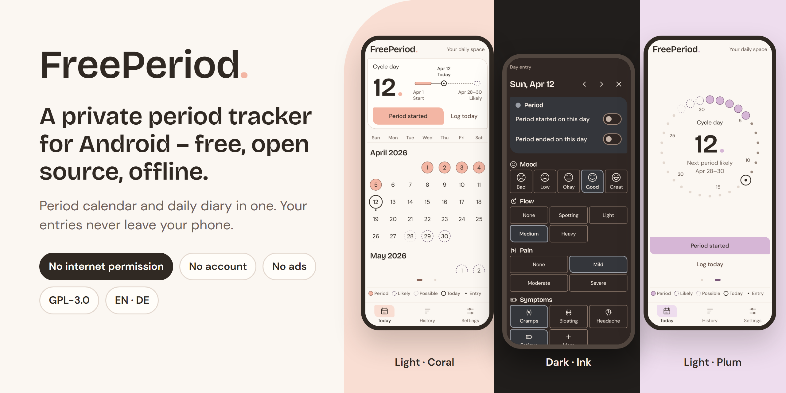
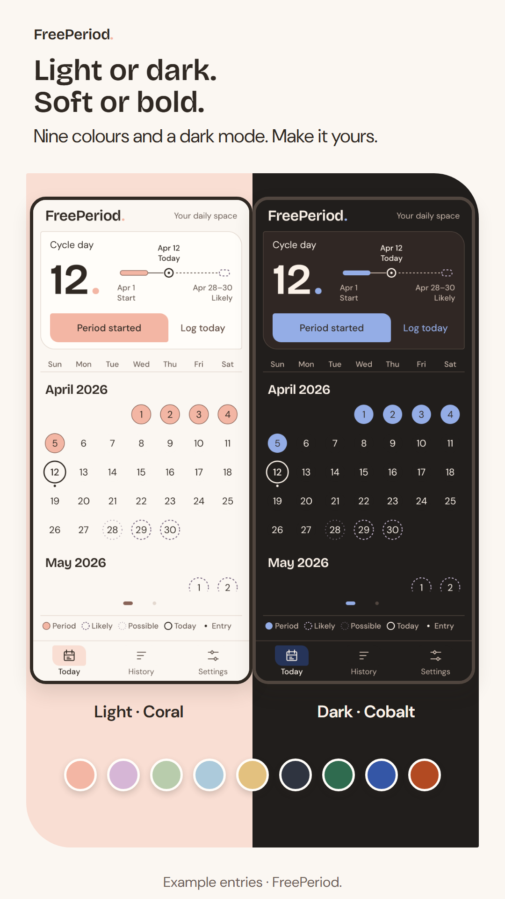
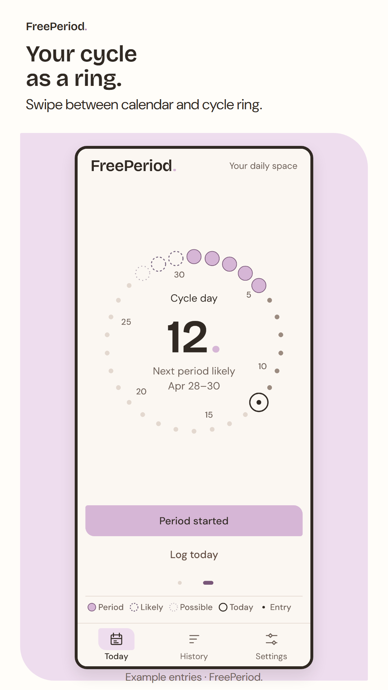
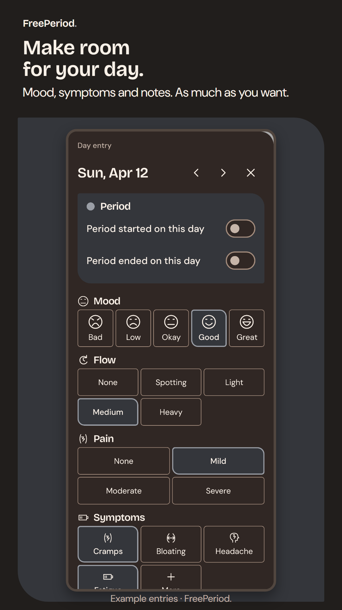
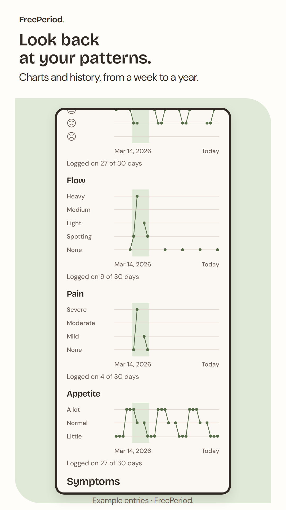
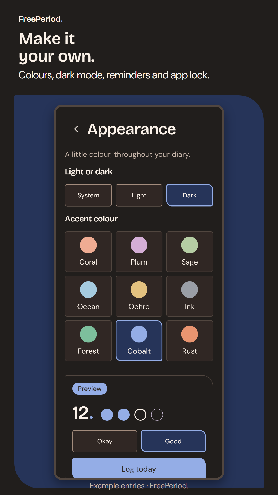
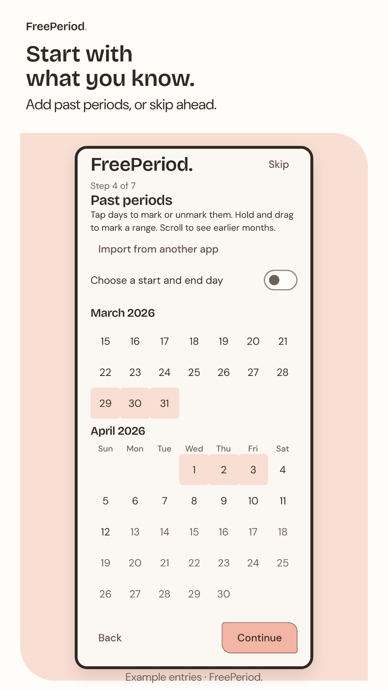
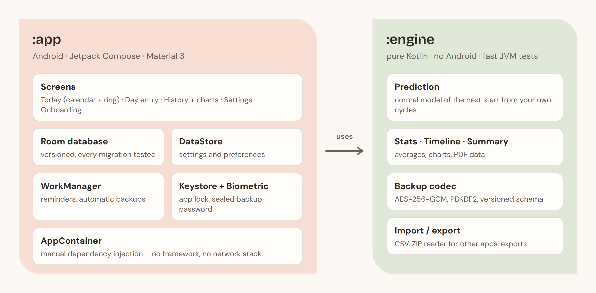

<p align="center">
  
</p>

<p align="center">
  <a href="https://play.google.com/store/apps/details?id=org.freeperiod.app"></a>
  <a href="LICENSE"></a>
  
  
</p>

<p align="center">
  <b>Period calendar and daily diary in one – free, open source and offline.</b><br>
  No account. No ads. No subscription. No analytics. The app has no internet permission at all,<br>
  so your entries physically can't leave your phone – and anyone can check that in this code.
</p>

<p align="center">
  <a href="https://play.google.com/store/apps/details?id=org.freeperiod.app">Google Play</a> ·
  <a href="https://pavoras.github.io/freeperiod/">Website</a> ·
  <a href="https://pavoras.github.io/freeperiod/privacy/">Privacy policy</a> ·
  <a href="#screenshots">Screenshots</a> ·
  <a href="#under-the-hood">Under the hood</a>
</p>

---

## Screenshots

<table>
  <tr>
    <td width="33%"></td>
    <td width="33%"></td>
    <td width="33%"></td>
  </tr>
  <tr>
    <td width="33%"></td>
    <td width="33%"></td>
    <td width="33%"></td>
  </tr>
</table>

Real app screens with example data (rendered by the screenshot tests). German versions: [`store/png/*-de.png`](store/png).

## Features

| | |
|---|---|
| **Calendar & cycle ring** | Log a period with one tap, see your cycle day at a glance – as a calendar or as a ring. |
| **Honest estimates** | The next two periods as calendar estimates from your own history, shown as *likely* / *possible* ranges. Optional days with a higher chance of pregnancy, always labelled as an estimate. |
| **Daily diary** | Mood, flow, pain, symptoms, discharge, notes and tags. Switch on appetite, sex drive, a medication log or a pain diary. Rename, reorder, hide anything; add your own categories and icons. |
| **History & charts** | Averages, logged symptoms and charts over a week, a month, 3 months or a year. |
| **PDF summary** | A clean summary of your entries, e.g. for a doctor's appointment. |
| **Life phases & methods** | Pill with pack rhythm, copper IUD, pregnancy, after birth, menopause – estimates adapt or pause, the diary stays. |
| **Reminders** | Period, pill or anything personal – scheduled on the phone. |
| **Your look** | System, light or dark; nine accent colours from soft pastels to dark and neutral. |
| **Your data, your files** | App lock (phone screen lock), encrypted backups (also automatic, into a folder you choose), CSV export/import, import from another period app's export. |
| **Languages** | English and German. |

FreePeriod is a diary, not a medical device, and not a method of contraception.

## Privacy by design

- **No `INTERNET` permission** in either build. The release gate fails if a merged release manifest contains it –
  including permissions pulled in by libraries (the Play Billing library's telemetry permission is removed).
- **No account, no server, no analytics or crash SDKs.** Everything is computed on the phone.
- **Backups** are encrypted with AES-256-GCM, key from PBKDF2-HMAC-SHA256 (600 000 iterations).
  The automatic-backup password is sealed with the Android Keystore.
- **Two builds**: `play` (with an optional one-time "support" purchase that unlocks nothing) and `fdroid`
  (free dependencies only, no Google libraries).

## Under the hood

<p align="center"></p>

- **Kotlin 2.2, Jetpack Compose, Material 3, Room, DataStore, WorkManager**, minSdk 26, targetSdk 36.
- **`:engine` is pure Kotlin** – prediction, statistics, backup format and import/export are plain JVM code with
  fast unit tests and no Android dependency.
- **Prediction**: the next start is modelled as a normal distribution (centre and spread from your cycle history);
  a day counts as *likely* from 60 % and *possible* from 30 %. No black box, no cloud.
- **~500 tests**: engine unit tests, Robolectric UI tests and **100+ Roborazzi screenshot references** in light, dark,
  large font and both languages. The store screenshots above are rendered from those same references.
- **Data compatibility is a rule**: every stored format only grows – each Room version has a tested migration, the
  backup format keeps readers for all older schemas, CSV stays re-importable.
- **No unnecessary dependencies**: the password-protected ZIP import (ZipCrypto) is a small reader in `:engine`
  instead of a library.

## Build

Requirements: JDK 17, Android SDK 36.

```bash
./gradlew :engine:test :app:testPlayDebugUnitTest   # tests
./gradlew :app:assembleFdroidDebug                   # F-Droid flavor debug APK
./gradlew :app:assemblePlayDebug                     # Play flavor debug APK
```

The full local gate (tests, screenshot comparison, lint, release builds, `INTERNET` check) is
`powershell -File tools\check.ps1 -Voll`. Store artwork: `py tools/render-store.py`; README images:
`py tools/render-readme.py`.

## Licence

GPL-3.0-only (see [`LICENSE`](LICENSE)).

Additional permission under GNU GPL version 3 section 7: If you modify this program, or any covered work, by
linking or combining it with the Google Play Billing Library (com.android.billingclient), containing parts
covered by the terms of the Android Software Development Kit License Agreement, the licensors of this
program grant you additional permission to convey the resulting work.

The Google Play build contains this library for the optional support purchase; the F-Droid build does not.
